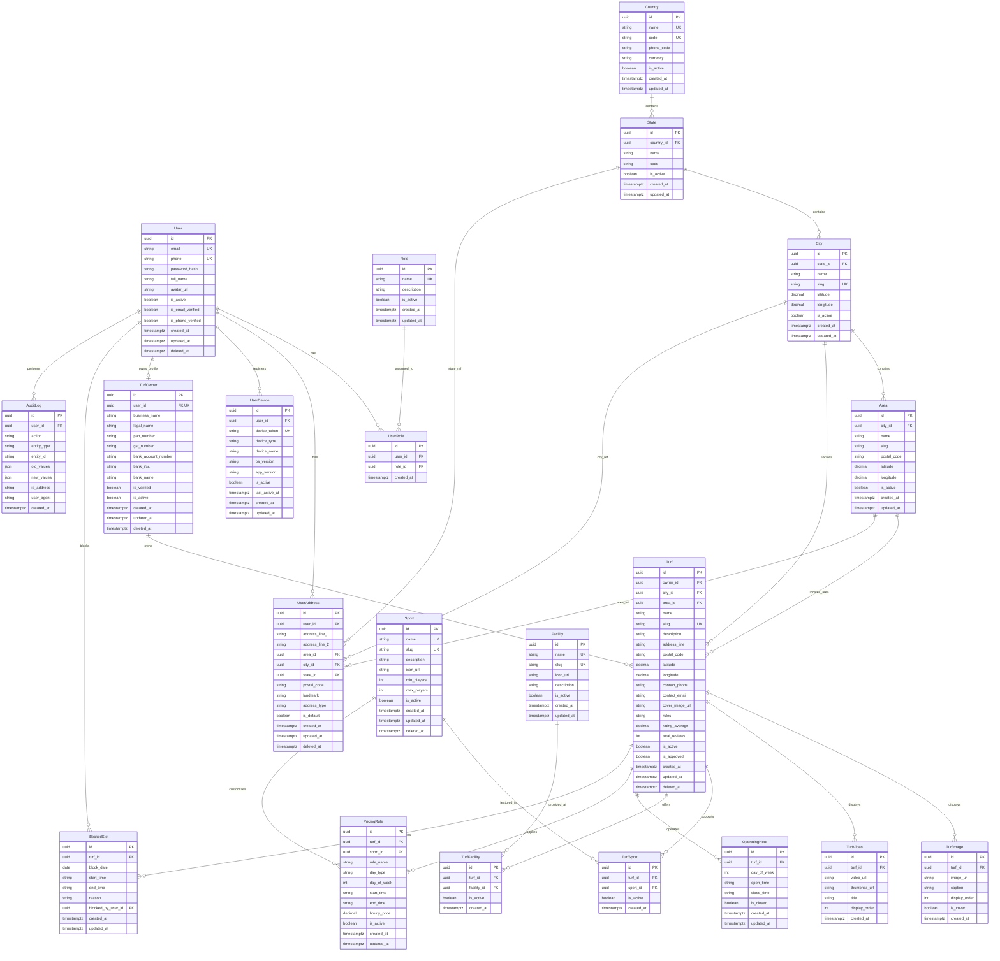

# 📊 Entity Relationship Diagram (ERD) - Core Database Schema

## Logical Database: `turf_booking_db`
**Platform**: Azure Database for PostgreSQL Flexible Server  
**ORM**: Prisma v6.19.3  
**Phase**: Phase 2 - Core Schema  

---

## 1. Visual Entity Relationship Diagram

---

## 2. Table Specifications & Referential Integrity

| Table Name | Primary Key | Foreign Keys | Cascade / Restrict Behavior | Unique Constraints | Primary Purpose |
|---|---|---|---|---|---|
| `users` | UUID | None | N/A | `email`, `phone` | Master account registry |
| `roles` | UUID | None | N/A | `name` | RBAC role definitions |
| `user_roles` | UUID | `user_id`, `role_id` | User: Cascade, Role: Restrict | `[user_id, role_id]` | Many-to-many user role mapping |
| `user_addresses` | UUID | `user_id`, `city_id`, `state_id`, `area_id` | User: Cascade, Locations: SetNull | None | Multi-address support for users |
| `user_devices` | UUID | `user_id` | User: Cascade | `device_token` | FCM push notification target tokens |
| `countries` | UUID | None | N/A | `name`, `code` | Top-level geographic entity |
| `states` | UUID | `country_id` | Country: Restrict | `[country_id, code]` | Regional states/provinces |
| `cities` | UUID | `state_id` | State: Restrict | `slug` | Operational cities |
| `areas` | UUID | `city_id` | City: Restrict | `[city_id, slug]` | Local neighborhoods/postal areas |
| `sports` | UUID | None | N/A | `name`, `slug` | Platform sports catalog |
| `facilities` | UUID | None | N/A | `name`, `slug` | Amenity and facility registry |
| `turf_owners` | UUID | `user_id` | User: Restrict | `user_id` | Business profile & KYC details |
| `turfs` | UUID | `owner_id`, `city_id`, `area_id` | Owner: Restrict, City: Restrict, Area: SetNull | `slug` | Multi-sport venue entities |
| `turf_images` | UUID | `turf_id` | Turf: Cascade | None | Image gallery metadata |
| `turf_videos` | UUID | `turf_id` | Turf: Cascade | None | Video tour metadata |
| `turf_sports` | UUID | `turf_id`, `sport_id` | Turf: Cascade, Sport: Restrict | `[turf_id, sport_id]` | Turf to sport mapping |
| `turf_facilities`| UUID | `turf_id`, `facility_id` | Turf: Cascade, Facility: Restrict | `[turf_id, facility_id]` | Turf amenity mapping |
| `operating_hours`| UUID | `turf_id` | Turf: Cascade | `[turf_id, day_of_week]` | 7-day schedule definition |
| `pricing_rules` | UUID | `turf_id`, `sport_id` | Turf: Cascade, Sport: SetNull | None | Day/time specific hourly rates |
| `blocked_slots` | UUID | `turf_id`, `blocked_by_user_id` | Turf: Cascade, User: SetNull | None | Maintenance/event blackout windows |
| `audit_logs` | UUID | `user_id` | User: SetNull | None | Immutable compliance audit trail |
