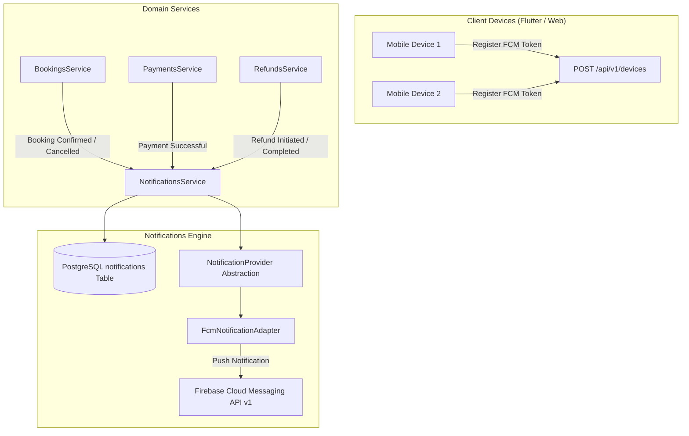

# Notifications & Firebase Cloud Messaging (FCM) Subsystem

## Overview

The Notifications Subsystem provides unified in-app notification inbox management and cross-platform push notifications (iOS, Android, Web) via Firebase Cloud Messaging (FCM). 

The application uses an extensible **Notification Provider Abstraction** (`NotificationProvider`), ensuring that FCM can be swapped for alternative providers (such as OneSignal, AWS SNS, Apple APNs direct, or WebPush) without modifying domain logic.

---

## Security & Configuration

> [!IMPORTANT]
> **No Firebase credentials are placed in source code.**
>
> Credentials are provided exclusively via environment variables through `ConfigService`:
> - `FIREBASE_PROJECT_ID`: Firebase project identifier
> - `FIREBASE_CLIENT_EMAIL`: Service account email
> - `FIREBASE_PRIVATE_KEY`: Service account private key
>
> When environment variables are not set (e.g. local development or unit tests), `FcmNotificationAdapter` automatically runs in mock mode, logging push events without failing or interrupting the user flow.

---

## Architectural Abstraction



### Notification Provider Interface

```typescript
export interface PushNotificationMessage {
  tokens: string[];
  title: string;
  body: string;
  data?: Record<string, string>;
  imageUrl?: string;
}

export interface PushNotificationResult {
  success: boolean;
  successCount: number;
  failureCount: number;
  provider: string;
  failedTokens?: string[];
}

export interface NotificationProvider {
  readonly providerName: string;
  sendPush(message: PushNotificationMessage): Promise<PushNotificationResult>;
}
```

---

## Notification Event Types

| Event Type | Recipient | Trigger Scenario | Title & Summary |
| :--- | :--- | :--- | :--- |
| `BOOKING_CONFIRMED` | Customer | Booking is confirmed after payment verification | *Booking Confirmed! 🏟️* |
| `OWNER_BOOKING_NOTIFICATION` | Turf Owner | New booking created or customer cancelled | *New Booking Received! ⚽* |
| `PAYMENT_SUCCESSFUL` | Customer | Payment signature verified or captured | *Payment Successful 💳* |
| `BOOKING_CANCELLED` | Customer & Owner | Customer or admin cancels an active booking | *Booking Cancelled* |
| `BOOKING_REMINDER` | Customer | Scheduled / triggered match reminder | *Match Reminder ⏰* |
| `REFUND_INITIATED` | Customer | Refund initiated by policy or owner/admin | *Refund Initiated 🔄* |
| `REFUND_COMPLETED` | Customer | Gateway refund successfully completed | *Refund Completed ✅* |

---

## API Specifications

### 1. Register Device FCM Token
`POST /api/v1/devices`  
**Authorization**: Bearer JWT (Customer, Owner, Admin)

#### Request Body
```json
{
  "deviceToken": "fcm_dK8sl39dmc...device_token",
  "deviceType": "ANDROID",
  "deviceName": "Google Pixel 8 Pro",
  "osVersion": "Android 14",
  "appVersion": "1.0.0"
}
```

#### Response (201 Created)
```json
{
  "success": true,
  "data": {
    "id": "21e428bc-8ef8-4903-8822-79401bfef6c1",
    "userId": "d741a312-d9c9-4ce8-b570-8b17b2b63ff5",
    "deviceToken": "fcm_dK8sl39dmc...device_token",
    "deviceType": "ANDROID",
    "deviceName": "Google Pixel 8 Pro",
    "isActive": true,
    "lastActiveAt": "2026-09-25T11:00:00.000Z"
  }
}
```

---

### 2. Unregister Device
`DELETE /api/v1/devices/:id`  
**Authorization**: Bearer JWT (Device Owner or Admin)

#### Response (200 OK)
```json
{
  "success": true,
  "data": {
    "message": "Device unregistered successfully"
  }
}
```

---

### 3. Get User Notifications
`GET /api/v1/notifications`  
`GET /api/v1/notifications?isRead=false&type=BOOKING_CONFIRMED&page=1&limit=20`  
**Authorization**: Bearer JWT

#### Response (200 OK)
```json
{
  "success": true,
  "data": {
    "items": [
      {
        "id": "e0b57e75-9b8e-4a62-b9b2-38e55353ffc1",
        "type": "BOOKING_CONFIRMED",
        "title": "Booking Confirmed! 🏟️",
        "body": "Your booking #TB-20261120-A1B2 for Champions Arena on 2026-11-20 at 18:00 is confirmed!",
        "data": { "bookingId": "...", "bookingNumber": "TB-20261120-A1B2" },
        "isRead": false,
        "readAt": null,
        "createdAt": "2026-09-25T11:05:00.000Z"
      }
    ],
    "total": 12,
    "page": 1,
    "limit": 20,
    "totalPages": 1,
    "unreadCount": 3
  }
}
```

---

### 4. Get Unread Notifications & Counter
`GET /api/v1/notifications/unread`  
**Authorization**: Bearer JWT

#### Response (200 OK)
```json
{
  "success": true,
  "data": {
    "unreadCount": 3,
    "items": [
      {
        "id": "e0b57e75-9b8e-4a62-b9b2-38e55353ffc1",
        "title": "Booking Confirmed! 🏟️",
        "isRead": false,
        "createdAt": "2026-09-25T11:05:00.000Z"
      }
    ]
  }
}
```

---

### 5. Mark Single Notification as Read
`POST /api/v1/notifications/:id/read`  
**Authorization**: Bearer JWT (Recipient only)

#### Response (200 OK)
```json
{
  "success": true,
  "data": {
    "id": "e0b57e75-9b8e-4a62-b9b2-38e55353ffc1",
    "isRead": true,
    "readAt": "2026-09-25T11:10:00.000Z"
  }
}
```

---

### 6. Mark All Notifications as Read
`POST /api/v1/notifications/read-all`  
**Authorization**: Bearer JWT

#### Response (200 OK)
```json
{
  "success": true,
  "data": {
    "success": true,
    "markedReadCount": 3
  }
}
```
